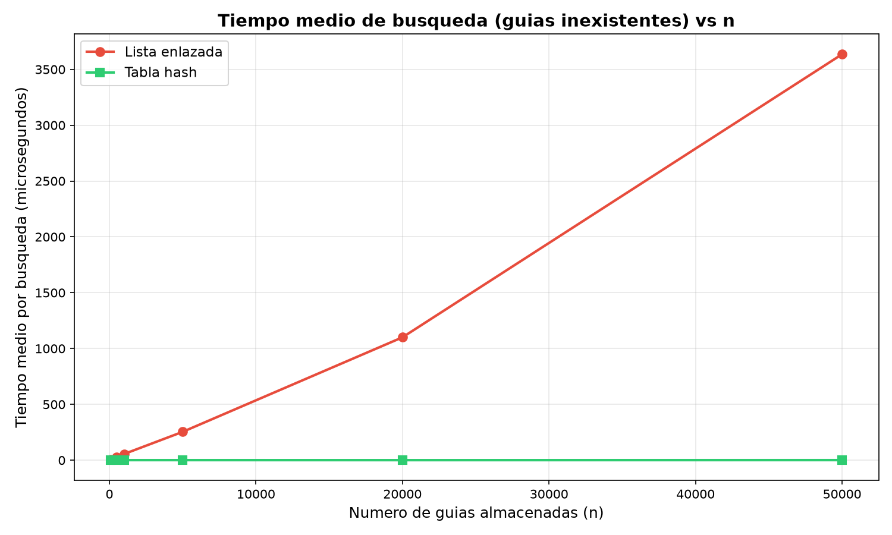
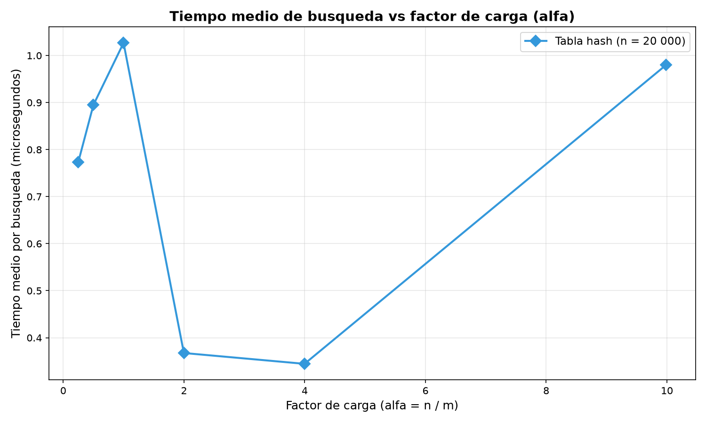

# Laboratorio 3 — Estructuras de Datos

**Juan Felipe Patiño**

## Instrucciones para reproducir

1. Active el entorno virtual desde la raíz del repositorio:

   ```bash
   # Windows
   venv\Scripts\activate

   # Linux / macOS
   source venv/bin/activate
   ```

2. Asegúrese de tener las dependencias instaladas:

   ```bash
   pip install -r requirements.txt
   ```

3. Ejecute las pruebas:

   ```bash
   cd laboratorios/lab3-estructuras-datos
   python pruebas.py
   ```

4. Ejecute las mediciones y genere las gráficas:

   ```bash
   python medicion.py
   ```

   Las gráficas se guardan en `graficas/`.

---

## Parte 1 — Implementación y verificación

**Código fuente:** [estructuras.py](estructuras.py) · [pruebas.py](pruebas.py)

Implementé dos estructuras de datos en `estructuras.py`:

- **`ListaEnlazada`**: lista simplemente enlazada con inserción al inicio en Θ(1) y búsqueda iterativa recorriendo nodo por nodo.
- **`TablaHash`**: tabla hash con encadenamiento que reutiliza `ListaEnlazada` en cada casilla. Usa la función hash por división `h(k) = k mod m`.

Las verificaciones en `pruebas.py` cubren los siguientes casos:

1. **Búsqueda exitosa e infructuosa** en la lista enlazada: se insertan cuatro guías y se verifica que se encuentran correctamente, y que buscar una guía inexistente devuelve `None`.
2. **Búsqueda exitosa e infructuosa** en la tabla hash: mismas verificaciones con la tabla.
3. **Colisión forzada con m = 7**: las guías 10, 24 y 17 caen todas en la casilla 3 (porque `10 % 7 = 24 % 7 = 17 % 7 = 3`). Se verifica que las tres se insertan y se buscan correctamente, y que la lista de la casilla 3 tiene longitud 3.
4. **Factor de carga**: tras insertar 3 guías con m = 7, `factor_carga()` devuelve `3/7`.
5. **Veinte colecciones aleatorias**: se generan 20 colecciones de entre 50 y 500 guías con semilla fija. Para cada colección se verifica que la lista y la tabla devuelven el mismo estado para guías existentes, y ambas devuelven `None` para guías inexistentes.

---

## Parte 2 — Mediciones y gráficas

**Código fuente:** [medicion.py](medicion.py)

### Experimento A — Lista enlazada vs Tabla hash

Se midió el tiempo medio de búsqueda de 200 guías inexistentes, promediando 3 repeticiones. Para cada valor de n, la tabla usa un m primo cercano a n/2, manteniendo α ≈ 2. Se cronometró únicamente la búsqueda con `time.perf_counter()`.

| n | m | α | Lista (μs) | Tabla (μs) |
|------:|------:|-----:|-----------:|-----------:|
| 100 | 53 | 1.89 | 7.65 | 0.67 |
| 500 | 251 | 1.99 | 28.45 | 0.59 |
| 1 000 | 503 | 1.99 | 55.36 | 0.52 |
| 5 000 | 2 503 | 2.00 | 253.84 | 0.53 |
| 20 000 | 10 007 | 2.00 | 1 100.36 | 0.36 |
| 50 000 | 25 013 | 2.00 | 3 635.12 | 0.68 |



### Experimento B — Efecto del factor de carga

Con n = 20 000 fijo, se varió m para obtener distintos valores de α. Se midió el tiempo medio de 200 búsquedas inexistentes con 3 repeticiones.

| α | m | Tiempo (μs) |
|------:|--------:|------------:|
| 0.25 | 80 021 | 0.77 |
| 0.50 | 40 009 | 0.89 |
| 1.00 | 20 011 | 1.03 |
| 2.00 | 10 007 | 0.37 |
| 4.00 | 5 003 | 0.34 |
| 10.00 | 2 003 | 0.98 |



---

## Parte 3 — Análisis

### 1. Costo teórico

Cuando busco una guía que no existe en la lista enlazada, toca recorrerla toda porque no hay forma de saber que la guía no está sin mirar cada nodo. Eso da un costo de Θ(n).

Con la tabla hash es diferente: primero calculo la casilla con `k mod m` (eso es O(1)) y después solo recorro la cadena de esa casilla. Como en promedio cada cadena tiene α = n/m elementos, el costo queda en Θ(1 + α). Ahora, esto solo se cumple si asumimos **hash uniforme simple**, o sea que cada guía tiene la misma probabilidad de caer en cualquiera de las m casillas. Si por alguna razón todas cayeran en la misma casilla, tendríamos una sola lista de n elementos y volveríamos a Θ(n).

### 2. Lo medido contra lo esperado

Mirando la primera gráfica, comparé n = 5 000 (253.84 μs) con n = 20 000 (1 100.36 μs). El tiempo se multiplicó por 1 100.36 / 253.84 ≈ 4.33 y n creció por un factor de 4. Que ambos factores sean tan parecidos confirma el crecimiento lineal Θ(n) de la lista.

La tabla hash, en cambio, pasó de 0.53 μs a 0.36 μs para esos mismos n. Básicamente se mantuvo igual, lo cual tiene sentido porque α estaba fijo en ≈ 2 y el costo es Θ(1 + α), que no depende de n.

En la segunda gráfica noté que de α = 4 (0.34 μs) a α = 10 (0.98 μs) el tiempo sí sube, coherente con Θ(1 + α). Para alfas bajos hay variaciones medio raras, pero eso es normal: cuando los tiempos son de fracciones de microsegundo, el ruido del caché y del sistema operativo pesa bastante.

### 3. Explique las colisiones

Hay una **colisión** cuando dos guías distintas dan el mismo índice de casilla. Esto pasa inevitablemente porque estamos metiendo un espacio enorme (guías de 10 dígitos) en solo m casillas; por el principio del palomar, tarde o temprano dos van a coincidir.

Por ejemplo, con m = 7 las guías 10, 24 y 17 dan todas casilla 3: `10 % 7 = 3`, `24 % 7 = 3`, `17 % 7 = 3`.

Con **encadenamiento**, cada casilla tiene su propia lista enlazada. Las tres guías quedan como nodos en la lista de la casilla 3, y cuando busco la 17 solo recorro esa cadena. Lo bueno es que no hay límite de cuántos caben y borrar es fácil. Lo malo es la memoria extra de los punteros.

Con **direccionamiento abierto** no hay listas: si la casilla está ocupada, se busca la siguiente libre (con sondeo lineal, cuadrático o doble hash). La 10 iría a la casilla 3, la 24 encuentra la 3 ocupada y pasa a la 4, la 17 a la 5. No gasta memoria en punteros, pero se forman agrupamientos que empeoran el rendimiento conforme α se acerca a 1, y borrar es complicado.

### 4. Tabla hash o árbol de búsqueda

Para consultas por rango ("guías entre X y Y") la tabla hash no funciona. El hash destruye el orden de las claves, entonces para sacar un rango tocaría recorrer toda la tabla: Θ(n + m).

Un **ABB** sí mantiene el orden. Para un rango [X, Y] bajo por el árbol hasta encontrar X y luego voy visitando los sucesores hasta pasar Y. Cada comparación baja un nivel, así que buscar una guía cuesta a lo sumo h comparaciones (la altura del árbol). Con 400 000 guías y un árbol equilibrado, h ≈ log₂(400 000) ≈ 19 comparaciones.

Pero si las 400 000 guías llegaran ordenadas y se insertaran sin balanceo, el árbol se vuelve una cadena lineal con h = 399 999. Buscar la última guía costaría 400 000 comparaciones en vez de 19: eso es pasar de O(log n) a O(n), una diferencia de más de 20 000 veces.

### 5. Concepto para la jefa de operaciones

Mi recomendación es usar **ambas estructuras a la vez**: una **tabla hash** con α ≈ 2 para las consultas puntuales del call center, y un **árbol equilibrado** (rojo-negro o AVL) para cuando los supervisores necesitan revisar rangos de guías.

**Estimación a 5 000 000 de envíos** (las siguientes son estimaciones basadas en mis mediciones):

- *Lista enlazada*: con 50 000 guías midió ≈ 3 635 μs. Como el crecimiento es lineal, con 5 000 000 (100 veces más) estimo unos 363 500 μs ≈ 0.36 s por búsqueda. Cada operador esperando más de un tercio de segundo por consulta.
- *Tabla hash* (α ≈ 2): en mis mediciones nunca pasó de 1 μs sin importar n. Como Θ(1 + α) no depende de n sino de α, y α se controla ajustando m, seguiría por debajo de 1 μs con 5 millones de guías.
- *Árbol equilibrado*: con h ≈ log₂(5 000 000) ≈ 23, serían unas 23 comparaciones, unos pocos microsegundos. Más lento que la tabla hash para búsqueda puntual, pero es el único que permite los rangos.

Con la tabla hash la espera del call center pasaría de ≈ 0.36 s a menos de 1 μs. El árbol resolvería los rangos en unas 23 comparaciones.
